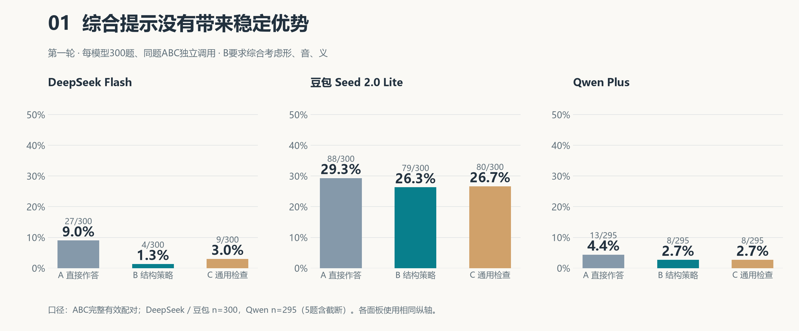
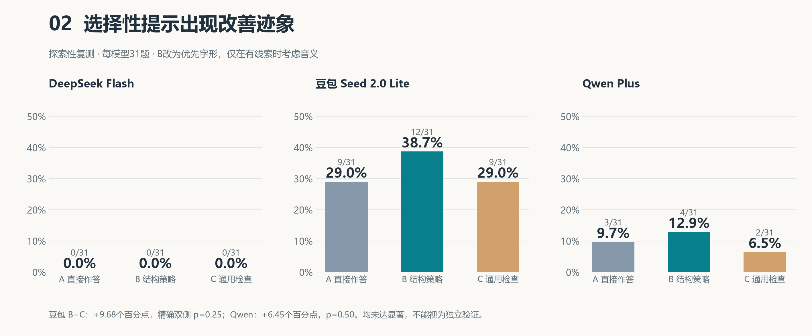
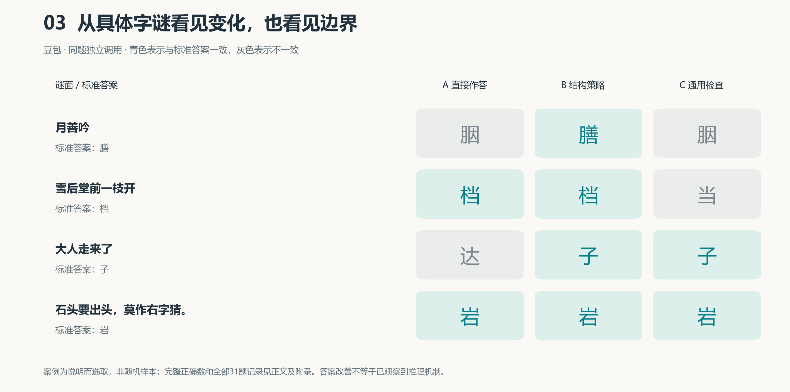

# 汉字字谜中的形音义提示实验（初步研究）

课程作业的代码与证据存档：三模型 ABC 对照、31题探索性复测，以及配对检验和图表。
本项目借助AI编写程序、辅助标注和核查结果；不把辅助标注视为人工金标准。

## 结果先看这里

第一轮：每模型300题。A直接作答，B综合形音义提示，C通用检查。

| 模型 | A | B | C |
|---|---:|---:|---:|
| DeepSeek Flash | 27/300 | 4/300 | 9/300 |
| 豆包 Seed 2.0 Lite | 88/300 | 79/300 | 80/300 |
| Qwen Plus（完整ABC配对） | 13/295 | 8/295 | 8/295 |



Qwen首轮5次截断涉及5题；按整题剔除用于上述配对，未将截断伪装成正常错误答案。

第二轮：从已用300题固定种子抽31题；B改为字形优先、按线索选择音义。

| 模型 | A | B | C |
|---|---:|---:|---:|
| DeepSeek Flash | 0/31 | 0/31 | 0/31 |
| 豆包 Seed 2.0 Lite | 9/31 | 12/31 | 9/31 |
| Qwen Plus | 3/31 | 4/31 | 2/31 |



豆包B−C为+9.68个百分点，精确双侧McNemar p=0.25；Qwen为+6.45个百分点，p=0.50。
按三模型主要比较Holm校正后分别为0.75、1.00。只能称为探索性改善迹象，不能称为显著效果。
DeepSeek全零没有足够信息区分策略，不能解释为策略等效。



## 数据来源与研究范围

- 数据集：[pku0xff/CC-Riddle](https://github.com/pku0xff/CC-Riddle)，论文：[CC-Riddle: A Question Answering Dataset of Chinese Character Riddles](https://arxiv.org/abs/2206.13778)。
- 上游许可：[CC BY-NC-SA 4.0](https://creativecommons.org/licenses/by-nc-sa/4.0/)。本仓库样本和派生标注按该许可使用；仅用于非商业课程研究，保留原作者署名与来源。未将数据改授MIT许可。
- 改动：固定种子20261009按human/gen来源比例抽300题（212/88），补充AI辅助题型标注；20261010从中简单随机抽31题并补充难度初标；保留原谜底。
- `structure.json`由本地CC-Riddle相关分解数据的once/radical字段统计，不是现场调用字形工具给模型喂答案。标签和标准答案均不进入API请求。
- 两轮2979条正式记录，仅300道独立谜题；第二轮不是独立测试集，且输出上限从256改为512，不能把跨轮变化仅归因于prompt。
- 本仓库验证固定设置下的字谜表现，不能独自证明模型理解或不理解汉字结构。原始记录包含所有模型，不按效果删除负面结果。

## 目录

- `汉字字谜_ABC实验.ipynb`：300题原实验；`31题_ABC探索性小测试.ipynb`：小样本探索。
- `src/run_experiment.py`、`common.py`：独立请求、提示、顺序、重试、限流、续跑。
- `src/pilot31.py`：31题实验与分析；`statistical_abc.py`：原实验统计。
- `data/`：冻结样本、结构特征和标注。AI辅助标签有不确定性，详见置信度/依据。
- `output/three_models_ABC_v1/`、`output/pilot31_v1/`：真实API记录和冻结方案，不含模拟测试数据。
- `paper/figures/`：三张图；`paper/empirical_audit.json`：正文统一完整ABC配对口径的检验表。

## 使用方法

Python 3.11或3.12，建议虚拟环境。安装依赖：

```bash
python -m pip install -r requirements-notebook.txt
python -m notebook
```

在仓库根目录打开Notebook，选择项目Python内核，按顺序运行。密钥通过getpass隐藏输入，只留在内存；不要把密钥写进源文件、输出或提交。
真实调用需要账户额度并会计费。本仓库已有完整结果；保持原配置运行正式格会跳过已保存记录，但预检仍会调用API。若要重新采集，应先把Notebook中的OUTPUT_ROOT或OUTPUT改为新的批次目录，不能删除原结果后混用。
供应商接口和模型可用性需以自己的账户为准；模型别名变化会影响复现，原记录保留requested/returned标识。

仅重新分析31题（无API调用）：

```bash
python -c "import sys,json; from pathlib import Path; sys.path.insert(0,'src'); from pilot31 import analyze; from notebook_workflow import PROVIDERS; analyze(json.loads(Path('data/pilot31.json').read_text(encoding='utf-8')),PROVIDERS,Path('output/pilot31_v1'))"
```

重绘论文三图：`python src/paper_visuals.py`。Windows默认使用微软雅黑，其他系统需安装中文字体并设置Matplotlib字体。
检查基本管线：`python -m unittest discover -s src -p test_pipeline.py`。

## 统计口径与版本

主比较B−C跨模型Holm校正；B−A/C−A六项为独立辅助家族。样本按谜题配对，非把请求数当独立样本。
原统计脚本可能按每对条件的可用题目计算；论文为三组图表一致统一采用完整ABC口径，以`paper/empirical_audit.json`为准。两者不能混用分母。
31题样本不做高维回归；难度分层只描述。latency_seconds含本地限流等待，不能作为模型思考时间解释。
仓库主分支可继续发展；课程报告引用具体commit，保存交作业时的不可混淆版本。代码及结果供检查复现，尚未做独立验证。
